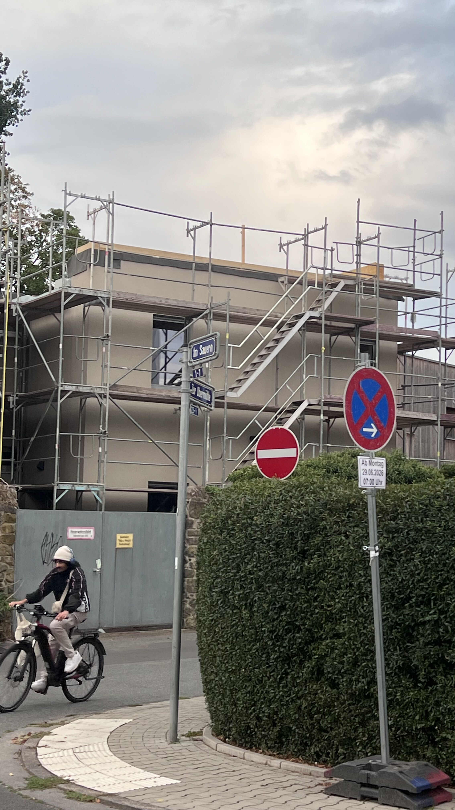

Here is a chronological visual timeline of the construction site progress, captured from start to finish. I'll add new impressions as soon as they're available.

  

    1 / 15
    August 21, 2026 - 19:50
  

  

    <button class="nav-btn prev-btn" onclick="prevSlide()" title="Previous Image">&#10094;</button>
    

      
    

    <button class="nav-btn next-btn" onclick="nextSlide()" title="Next Image">&#10095;</button>
  

  

    <button id="play-pause-btn" class="control-btn" onclick="togglePlay()">⏸ Pause</button>
    

      <input type="range" id="timeline-slider" min="0" max="14" value="0" oninput="slideFromSlider(this.value)">
    

  

  

    <!-- Thumbnails populated by JS -->
  

